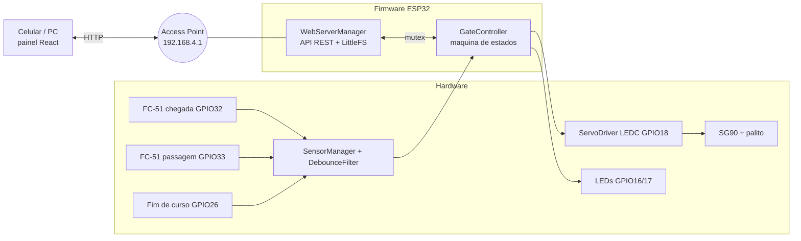

# Arquitetura

## Diagrama de blocos



## Módulos

| Arquivo | Responsabilidade |
|---|---|
| `include/config.h` | Pinos, filtros, tempos, SSID/senha. **Único lugar a editar para calibrar** |
| `DebounceFilter.h` | Filtro de tempo assimétrico (liga/desliga). Sem Arduino |
| `SensorManager` | Lê pinos, aplica filtros, entrega `GateInputs` |
| `GateController` | Máquina de estados, comandos, métricas, log de eventos. **Sem Arduino** |
| `ServoDriver` | PWM 50 Hz via LEDC (sem biblioteca externa) |
| `WebServerManager` | AP, rotas HTTP, JSON, arquivos do LittleFS (com suporte a `.gz`) |
| `main.cpp` | `loop()`: sensores → estados → saídas; sem `delay` na lógica |
| `frontend/` | Código-fonte React (Vite): `App.jsx` (painel), `api.js` (fetch com timeout) |
| `data/` | Saída do build do frontend, gravada no LittleFS (`app.js.gz`, `index.css.gz`, `index.html`) |

## Frontend React

- `npm run build` (em `frontend/`) gera `data/` com nomes fixos (sem hash) e comprime `app.js` e `index.css` em gzip (~70 KB no total). O ESP32 envia os `.gz` com `Content-Encoding: gzip`.
- Node.js é necessário **só no PC** para recompilar a interface. O ESP32 serve arquivos estáticos.
- O hook `usePolling` consulta `/api/status` a cada 500 ms e `/api/metrics` a cada 3 s. Sem resposta válida por 2,5 s: "Sem conexão", dados escurecidos e botões desativados.
- Um comando por vez (`busy`): evita cliques repetidos. Respostas 400/409/erros de rede viram mensagens ao usuário.

## Concorrência

- `loop()` roda no núcleo 1 a cada ~1 ms: lê sensores, atualiza a máquina, escreve servo/LEDs.
- O servidor HTTP roda em **tarefa própria no núcleo 0**. Um cliente lento ou desconectado a meio de uma requisição **não atrasa** o servo nem as verificações de segurança.
- `GateController` e `SensorManager` são protegidos por um mutex (`Sync.h`). Os handlers HTTP só chamam `requestOpen/Close/Mode/ResetFault`, que passam pelas regras de segurança; nenhum handler escreve no servo.

## Servo sem bloqueio

A máquina mantém um ângulo comandado que avança com `grau/ms = |open − closed| / tempo_de_percurso` a cada ciclo. Isso gera uma rampa suave (menos corrente de pico, menos solavanco) e permite reverter no meio do caminho. **O ângulo é o comandado, não o medido**: o SG90 não tem realimentação para o ESP32.

## Comunicação Wi-Fi

O ESP32 cria o Access Point `Cancela-ESP32` (senha `cancela123`, canal 6, IP `192.168.4.1`). O celular conecta direto, sem roteador nem internet. (Alguns celulares avisam "sem internet": mantenha a conexão.)

- O frontend usa *polling*: simples e robusto. Se a rede cai, a próxima consulta recupera sozinha, sem conexão persistente para tratar.
- Desconexão de **cliente HTTP** ≠ queda do **Access Point**: ver `maquina_estados.md`.

## API REST

| Método e rota | Função | Respostas |
|---|---|---|
| `GET /api/status` | Estado completo (JSON) | 200 |
| `GET /api/metrics` | Contadores e medições T01/T02/T05 | 200 |
| `POST /api/open` | Pede abertura | 200 / 409 |
| `POST /api/close` | Pede fechamento | 200 / 409 |
| `POST /api/mode` (`mode=auto\|manual`) | Muda modo | 200 / 400 |
| `POST /api/reset-fault` | Pede recuperação | 200 / 409 |
| `POST /api/release-entry` | Operador libera UMA entrada (exige vaga e cancela sem falha) | 200 / 409 |
| `POST /api/release-exit` | Operador libera UMA saída (exige veículo dentro) | 200 / 409 |
| `POST /api/parking/occupied` (`value=N`) | Ajusta a ocupação (0 a capacidade) | 200 / 400 |
| `POST /api/sim/limit` (`masked=0\|1`) | **Só no ambiente `faultsim`**: mascara o fim de curso | 200 / 400 |

Resposta de comandos: `{"ok":true|false,"message":"..."}`. Rotas inexistentes: 404 em JSON. O firmware não possui caminho que gere 500 deliberadamente.

Exemplo de `GET /api/status`:

```json
{"state":"ABERTA","mode":"AUTOMATICO","stateAgeMs":2310,"uptimeMs":48000,
 "fault":{"code":"NENHUMA","message":""},
 "parking":{"capacity":5,"occupied":2,"free":3,"auth":"NENHUMA","entries":4,"exits":2,"deniedFull":0},
 "sensors":{"arrival":false,"obstacle":false,"limit":false},
 "servo":{"angle":90.0,"enabled":true},"leds":{"green":true,"red":false},
 "wifi":{"ssid":"Cancela-ESP32","stations":1,"apUp":true},
 "faultSim":{"enabled":false,"limitMasked":false},
 "events":[{"t":45690,"msg":"Aberta (estimado por tempo)"}]}
```

## Estacionamento

`GateController` guarda a ocupação e uma **autorização** (`NENHUMA`, `ENTRADA`, `SAIDA`). A autorização nasce na chegada automática (se houver vaga) ou por `release-entry/exit`, e é consumida quando o sensor de passagem **ativa e desativa** (filtrado) com a cancela ABRINDO/ABERTA/FECHANDO. Ao entrar em FECHADA ou FALHA ela expira. Com autorização pendente, o fechamento automático espera `authWaitMs` (8 s) de passagem livre, para dar tempo ao veículo de chegar ao sensor. O estado fica na RAM: reiniciar o ESP32 zera a ocupação.

## Simulador (desenvolvimento)

`frontend/mock/` é um plugin do Vite que responde `/api/*` com uma cópia JavaScript da lógica, mais rotas `/api/sim/*` para mexer nos sensores virtuais. Só existe no modo de desenvolvimento; não entra no `build` nem no ESP32.

## Filtragem (Desafio 1)

`DebounceFilter` só muda o valor depois que a leitura bruta ficou estável por um tempo: chegada 60 ms liga / 150 ms desliga; passagem 20 ms liga / 300 ms desliga (detecta rápido, libera devagar); fim de curso 30 ms. Além disso o valor **bruto** do sensor de passagem também bloqueia o fechamento, sem esperar o filtro.
