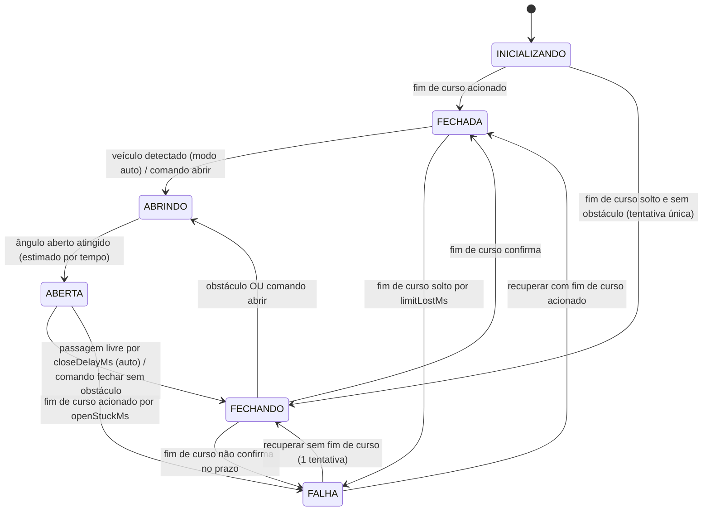

# Máquina de estados

Implementada em `src/GateController.cpp` (lógica pura, sem Arduino, testada no PC).

## Diagrama

## Estados

| Estado | Entrada | Saída | LED vermelho | LED verde | Servo |
|---|---|---|---|---|---|
| INICIALIZANDO | Boot | Fim de curso lido (ou obstáculo sai, se havia) | aceso | apagado | **sem PWM** até ser seguro |
| FECHADA | Fim de curso confirmou | Chegada (auto) ou comando abrir; ou falha do fim de curso | aceso | apagado | mantém ângulo fechado |
| ABRINDO | Início de abertura | Ângulo aberto atingido (tempo) | aceso | apagado | rampa até `angleOpen` em `travelOpenMs` |
| ABERTA | Abertura concluída (estimada) | Fechamento autorizado ou falha | apagado | **aceso** (sem falha) | mantém `angleOpen` |
| FECHANDO | Fechamento autorizado | Fim de curso, obstáculo, comando abrir ou timeout | pisca lento (500 ms) | apagado | rampa até `angleClosed` em `travelCloseMs` |
| FALHA | Timeout / fim de curso incoerente | Somente `reset-fault` válido | pisca rápido (150 ms) | apagado | mantém último ângulo, **nenhum movimento automático** |

## Transições permitidas e proibidas

| De \ Comando | `open` | `close` | `reset-fault` | `mode` |
|---|---|---|---|---|
| INICIALIZANDO | 409 | 409 | 409 | 200 |
| FECHADA | **200** | 409 (já fechada) | 409 (sem falha) | 200 |
| ABRINDO | 409 | 409 (aguarde) | 409 | 200 |
| ABERTA | 409 (já aberta) | **200** se sem obstáculo, senão 409 | 409 | 200 |
| FECHANDO | **200** (reverte, é seguro) | 409 | 409 | 200 |
| FALHA | 409 | 409 | 200 se sem obstáculo, senão 409 | 200 |

`mode` inválido (diferente de `auto`/`manual`) retorna **400**.

Transições **proibidas** (não existem no código): FECHADA→FECHANDO, ABRINDO→FECHANDO,
FALHA→ABRINDO/ABERTA, qualquer saída de FALHA sem `reset-fault`.

## Prioridade das condições de segurança

1. Obstáculo (filtrado **ou** bruto) em FECHANDO → reabre imediatamente. Vence qualquer comando.
2. `startClosing()` recusa iniciar se houver obstáculo (barreira final; contador `closeStartedWithObstacle` deve ficar em 0).
3. Falha ativa → bloqueia abrir e fechar.
4. Só depois vêm os comandos remotos e o modo automático.

Os modos AUTOMÁTICO e MANUAL **mantêm todas essas proteções**. Diferença: no manual a cancela não abre
na chegada do carro nem fecha sozinha.

## Comportamento seguro na inicialização

O ESP32 não sabe onde o palito está ao ligar. Regras:

- Nenhum pulso PWM é gerado enquanto o estado for INICIALIZANDO sem decisão.
- Fim de curso acionado → FECHADA (posição confirmada fisicamente).
- Fim de curso solto e passagem livre → **uma** tentativa de fechamento lento (o ângulo assumido parte de `angleOpen`). Se não confirmar, FALHA.
- Fim de curso solto e obstáculo presente → espera sem mover.

## Falhas detectadas

| Código | Condição | Causas prováveis | Detecção |
|---|---|---|---|
| `FIM_CURSO_TIMEOUT` | Servo chegou a `angleClosed` e o fim de curso não acionou em `limitConfirmMs` | Fim de curso mal posicionado/solto/fio rompido; palito travado; servo sem alimentação | Total máx. = `travelCloseMs + limitConfirmMs` (3000 ms por padrão) |
| `FIM_CURSO_PRESO` | Fim de curso continua acionado por `openStuckMs` com a cancela ABERTA | Servo sem energia/travado; chave colada; fio em curto | Após abertura estimada |
| `FIM_CURSO_PERDIDO` | Fim de curso solta por `limitLostMs` com a cancela FECHADA | Palito empurrado/deslocado; fio solto | Contínua em FECHADA |

**Não detectável** com um único fim de curso: posição real durante o movimento e na posição aberta; servo
com folga ou engrenagem quebrada se o palito ainda acionar a chave; queda de tensão que não impeça o
movimento; ruído que não passe pelo filtro. A abertura é **estimada por tempo**, nunca confirmada.

## Procedimento de recuperação (`POST /api/reset-fault`)

1. Corrija a causa física (reposicione a chave, solte o palito, verifique a alimentação do servo).
2. Remova qualquer objeto da passagem (senão 409).
3. Envie o reset:
   - Fim de curso acionado → FECHADA direto.
   - Fim de curso solto → **uma** tentativa de fechamento lento (o servo vai ao ângulo aberto e fecha em `travelCloseMs`). Se falhar de novo → FALHA. **Nunca há repetição automática.**

## Perda de Wi-Fi

| Situação | Efeito | Tratamento |
|---|---|---|
| Cliente (celular) desconecta ou a aba fecha | Nenhum no firmware. Laço de sensores/estados é independente do HTTP | Segue o modo atual. Ao reconectar, o painel se atualiza sozinho. O frontend mostra "Sem conexão" após 2,5 s sem resposta |
| Access Point deixa de existir | Gate segue funcionando localmente | A tarefa web verifica o AP a cada 5 s, reinicia e registra o evento |
| Cliente travado no meio de uma requisição | Só a tarefa web (núcleo 0) é atrasada | Servo/sensores rodam no `loop()` (núcleo 1) |

Segurança em primeiro lugar: nenhum comando pendente é "guardado" para executar após a reconexão.
